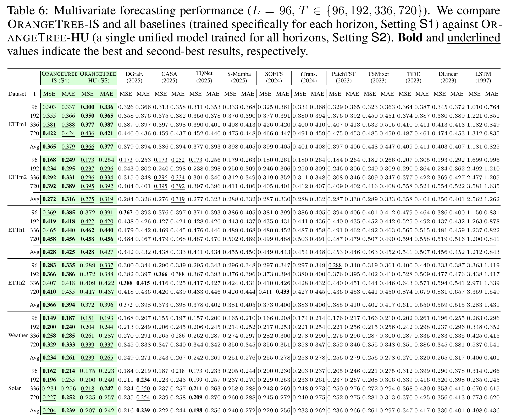
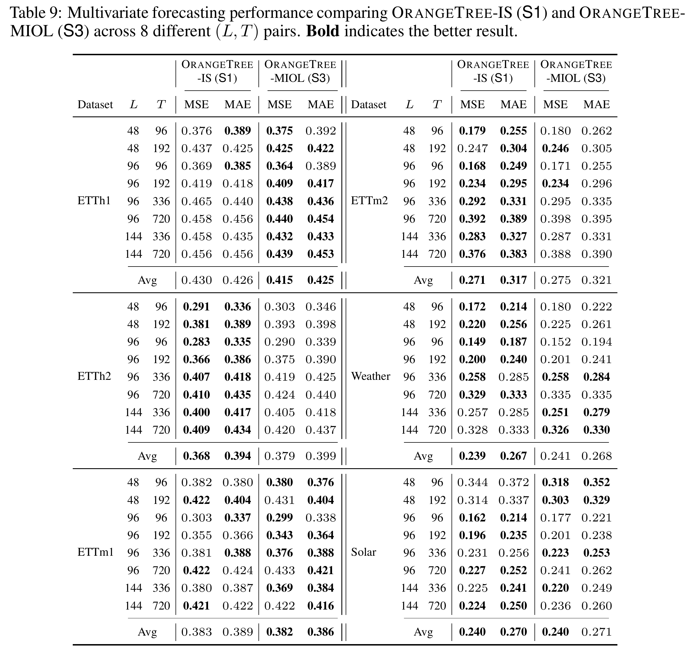

# OrangeTree

Code for the **NeurIPS 2026** paper:

**OrangeTree: A Linear and Tree-based Time Series Forecasting Model Supporting Multiple Input and Output Lengths**

## Abstract

Time series forecasting (TSF) models suffer from a critical rigidity: the inability to handle Multiple Input and Output Lengths (MIOL) within a single architecture. Current workarounds, such as padding or autoregression, often incur computational redundancy or suffer from error accumulation. We propose OrangeTree, a linear and tree-based architecture that decouples model parameters from sequence lengths. It employs a Segment Tree Encoder and an Inverse Tree Decoder to translate multi-length input history into multi-length output predictions within a unified framework. Crucially, a Range Weighter and a Feature Fuser bridge these components, dynamically selecting and fusing relevant ranges into optimal contexts for forecasting. Experiments on six benchmarks confirm OrangeTree achieves the SOTA performance. In MIOL settings, it matches the accuracy of length-fixed models without substantial accuracy degradation or a substantial increase in inference latency typical of heuristic methods.

## Getting started

Place the dataset CSV files in `datasets/`:

```text
datasets/
├── ETTh1.csv (included)
├── ETTh2.csv (included)
├── ETTm1.csv (included)
├── ETTm2.csv (included)
├── weather.csv
└── solar.csv
```

Once the data and directories are ready, run the following command from the repository root to start training with the default configuration:

```bash
python main.py
```

To run the experiments reported in the paper, use the experiment scripts provided in [`scripts/`](scripts/).

## Experimental results




